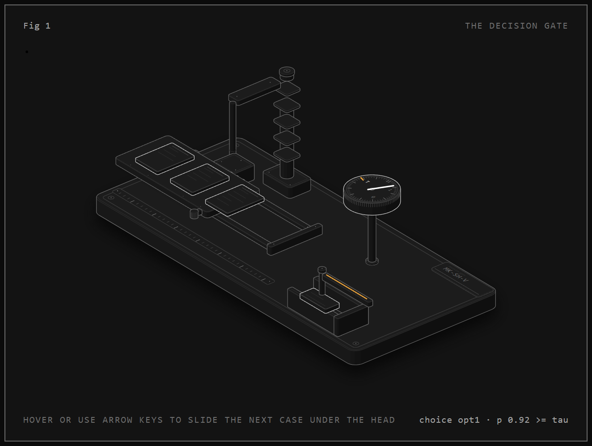

<!-- Local mirror of the Hugging Face model card. The HF card is canonical once the model is uploaded; update there first and re-sync this file. -->

<table><tr>
<td><h1>MK-SH-V</h1></td>
</tr></table>

**a 260M visual decision model: a page or screenshot in, calibrated
probabilities out, a choice, and a refusal below the gate**

A decision model of about 260M parameters that answers typed questions over
a described state **and an image**: given an image (a document page or a
mobile or desktop screenshot), a state, a question and a list of options, it returns
calibrated probabilities, a choice, and an explicit abstention when
confidence is insufficient. One single tower reads pixels and text in the
same pass; each option is marked inline and scored by a shared head. Its
differentiating capability is measured abstention: a decision threshold
whose selective risk was validated on held-out data with exact
Clopper-Pearson bounds, under criteria frozen before any measurement.

<video src="https://cdn.jsdelivr.net/gh/Gjusev/mk-sh-v@main/assets/brag.mp4" controls muted></video>

The published weights are the two E41 checkpoints (seed 42 sha256
`e4b4f6f5…`, seed 43 sha256 `30f2eb42…`, best step 2,000 each), trained with
the E39 recipe plus real CC-BY data (CORD train receipts, GUI-Odyssey
task_split train episodes). Calibration and the abstention policy were added
afterwards in experiment E42, fitted on dedicated calibration splits without
touching a single weight. `release/inference-policy.json` carries the full
policy: the temperature, the gate, and the response semantics.

## What it is for

Each case names the measured capability it rests on, and where that
measurement stops.

1. **Decisions over screenshots and document pages.** "Does this screenshot
   show the goal as completed", document type and form state, urgency of a
   ticket shown on screen. Rests on real-image accuracy 0.765/0.742 on 2,586
   held-out cases (CORD receipts + GUI-Odyssey screenshots, E41): on
   GUI-Odyssey task completion the 260M model reaches 0.826/0.783 against
   0.731 for a zero-shot ~4B comparator and 0.472 for an OCR pipeline.
   Bound: two decision families mapped from those sources into binary
   questions in EN/ES/DE with our templates; on CORD receipt thresholds the
   model (0.550/0.602) stays below a deterministic rules baseline (0.594)
   and the large comparator (0.972).
2. **Calibrated probabilities with a safety valve.** Temperature T and
   gate τ fitted on calibration splits disjoint from every reported set
   (E42): on the held-out synthetic test, both checkpoints keep over 86 %
   coverage with a 95 % Clopper-Pearson upper bound on selective risk of
   3.23 % and 3.43 % (budget 5 %). Suited to decision queues where refusals
   go to human review. Bound: that guarantee is protocol- and
   distribution-specific (our synthetic families). On real screenshots the
   gate currently keeps 98 % of cases while 17 to 21 % of kept answers are
   wrong; on real receipts it abstains from almost everything (coverage
   2 to 12 %). No abstention claim is made beyond the evaluated protocol.
3. **Mixed text and visual decision queues.** Text competence is retained
   through replay-mixing: 1.000/1.000 on the MK-SH-1 numeric order set
   (testC, MK-SH-1 itself 0.979) and 0.810/0.830 on the routing task set
   (MK-SH-1 0.800). Bound: descriptive only; the shipped policy was fitted
   on the visual calibration split, and task-set selective risk is 16 to 18 %.
4. **A methodological template.** Six experiments (E37 to E42) with criteria
   frozen and committed before each measurement, per-case outputs for every
   number, episode-grouped statistics, and published failure modes. Bound:
   one architecture, two real sources, 260M scale; not claimed beyond what
   the campaign measured.

## Measured capability

Real images, held-out 2,586 cases (labels from each source's ground truth;
details and provenance in the training repo):

| Arm | Params | Real overall | CORD thresholds | GUI task done | Regime |
|---|---|---|---|---|---|
| **MK-SH-V s42** | **260M** | **0.765** | 0.550 | **0.826** | task-trained |
| **MK-SH-V s43** | **260M** | **0.742** | 0.602 | 0.783 | task-trained |
| jev-vlm-4b | ~4B | 0.785 | 0.972 | 0.731 | zero-shot |
| OCR → MK-SH-1 | ~25M | 0.475 | 0.486 | 0.472 | task-trained |
| Same model, synthetic-only training | 260M | 0.471 | 0.394 | 0.493 | task-trained |

Moving from synthetic-only training to +10k real CC-BY rows (disjoint
splits) changed real accuracy by +29.4 pp (CI95 [+25.9, +32.9], seed 42) and
+27.2 pp ([+23.3, +31.3], seed 43), paired by episode. Overall the two
seeds are statistically close to the ~15× larger zero-shot comparator
(Δ CI95 [−5.4, +1.2] pp seed 42), which may have seen the evaluation
sources in pretraining; unverifiable from its card.

Synthetic held-out test (own generator, 7 families, 4,200 cases):
0.908/0.909, a declared −2.5 pp versus the synthetic-only model,
concentrated in field_threshold and form_complete (real-data number formats
compete with the synthetic EUR convention); the other five families are at
ceiling. French test 0.874/0.884.

## Calibration & abstention (experiment E42)

Protocol, frozen before any measurement: T fitted by NLL on
`cal_temperature` (3,150 synthetic calibration cases); τ chosen on a
separate `cal_policy` split (3,150) as the smallest grid value whose
Clopper-Pearson 95 % upper bound on selective risk stays within the 5 %
budget; held-out sets reported with exact two-sided CP intervals, budget on
the upper end. Unlike an in-sample policy, every reported number below is
out-of-sample for both T and τ.

> On our held-out synthetic evaluation, both 260M checkpoints achieved over
> 86 % coverage while maintaining a 95 % Clopper-Pearson upper confidence
> bound on selective risk below 5 %.



The gate as an instrument: the amber mark is tau on the probability dial,
and the three pages are real calibration cases with measured probabilities
(two pass the gate, one abstains). Interactive version in the demo.

| Set | n | Coverage | Selective risk | 95 % interval | Budget |
|---|---|---|---|---|---|
| s42 synthetic test (non-FR) | 4,200 | 0.861 | 2.65 % | 2.2 to 3.2 % | **held** |
| s43 synthetic test (non-FR) | 4,200 | 0.864 | 2.84 % | 2.3 to 3.4 % | **held** |
| s42 synthetic test FR | 1,400 | 0.834 | 5.66 % | 4.4 to 7.1 % | point only |
| s43 synthetic test FR | 1,400 | 0.841 | 5.78 % | 4.5 to 7.3 % | point only |
| s42 real GUI | 2,010 | 0.983 | 16.7 % | 15.1 to 18.4 % | missed |
| s43 real GUI | 2,010 | 0.983 | 21.3 % | 19.5 to 23.1 % | missed |
| s42 real CORD | 576 | 0.023 | 38.5 % | 13.9 to 68.4 % | missed |
| s43 real CORD | 576 | 0.123 | 23.9 % | 14.6 to 35.5 % | missed |
| s42/s43 text testC | 48 | 1.000 | 0 % | 0 to 7.4 % | n too small |
| s42/s43 text task | 300 | 0.990 | 16.5 to 18.2 % | 12.5 to 23.1 % | missed |

T = 1.5455 (s42) and 1.2929 (s43), τ = 0.55 both; the full risk/coverage
curves per set and family are in the training repo (`runs/e42-calib/`,
deterministically regenerable). ECE after T: synthetic test 0.011/0.006,
real GUI 0.10/0.16, real overall 0.10/0.14. The confidence signal that
works on the synthetic distribution does not yet separate right from wrong
on real images: that is the campaign's declared open problem, not a hidden
one.

## Usage

```python
import json, torch
from PIL import Image
from mokka_decisions.contracts import DecisionCase, Option
from mksh_v.arch_a1v import NeoMMEMarkerScorer, forward_a1v

policy = json.load(open("release/inference-policy.json", encoding="utf-8"))
T = policy["temperature"]["value"]        # fitted on cal_temperature (E42)
tau = policy["abstention"]["threshold"]   # fitted on cal_policy (E42), CP-upper rule

model = NeoMMEMarkerScorer()              # Hcompany/NeoMME-260M backbone
model.ensure_markers(32)
ckpt = torch.load("a1v_real_s42_best.pt", map_location="cpu", weights_only=True)
model.load_state_dict(ckpt["model"]); model.eval()

case = DecisionCase(
    id="demo", group_id="demo", source="demo", language="en", domain="screens",
    state="Goal: print orders_nov.csv for the records",
    question="Does the screenshot show the goal as completed?",
    options=(Option(id="false", description="No"), Option(id="true", description="Yes")))
enc = model.encode_cases([case], max_state_tokens=700, max_option_tokens=96)
batch = model.build_batch(enc, [Image.open("screenshot.png").convert("RGB")],
                          "cpu", max_side=1024)
with torch.inference_mode():
    logits = forward_a1v(model, batch)            # one pass over image + text
    probs = (logits / T).softmax(-1)[0].tolist()  # calibrated probabilities
top = max(range(len(probs)), key=lambda i: probs[i])
choice = case.options[top].id if probs[top] >= tau else None  # below tau: abstain
```

## Architecture

`NeoMMEMarkerScorer`: single NeoMME-260M tower (Hcompany, Apache-2.0),
fine-tuned with a marker head. Sequence layout per case:
`<doc> image-patch-grid state <eos> question [O0] option_0 [O1] option_1 …`;
each option is marked by a learned inline marker token, the shared head
scores every marker in one pass, and the softmax runs over the valid
options only. It is not a chat model and generates no text.

## Training / calibration provenance

Weights: E41 seeds 42/43, initialised from the E37 C3 checkpoint (sha
verified), 2,000 steps, effective batch 32, every 4th microbatch E35 text
replay and one slot of 4 real images (CORD train receipts; GUI-Odyssey
task_split train episodes), longest side 1,024 px, dev-half + real-dev
selection. Calibration + policy: experiment **E42** (criteria frozen before
measurement; τ chosen by the CP-upper rule adopted from E40's evidence
before any E41 calibration output existed). Full record:
[github.com/Gjusev/mk-sh-v](https://github.com/Gjusev/mk-sh-v)
(`docs/E37…E42 criteria`, `docs/status.md`, per-case files under `runs/`).

## Limitations (declared)

- Abstention is validated on the synthetic protocol only; on real images the
  gate either keeps confident errors (GUI) or refuses nearly everything
  (CORD). Per-domain thresholds or an OOD signal are open work.
- CORD receipt thresholds remain below the rules baseline; threshold
  questions over IDR-formatted totals are the largest accuracy gap.
- The real evaluation set (E38c) informed the error analysis that motivated
  the training data; it was never trained or tuned on, and all selection
  used separate dev splits. Disclosed for completeness.
- Single global temperature per checkpoint; text-set probabilities inherit
  a policy fitted on the visual calibration split (reported descriptively).
- 48-case text set cannot certify a ≤5 % CP upper bound even at zero errors.

## Attribution

- Backbone: [NeoMME-260M](https://huggingface.co/Hcompany/NeoMME-260M)
  (Hcompany), Apache-2.0, fine-tuned by this project.
- Training data: CORD v2 train (Park et al. 2019, NAVER Clova, CC BY 4.0);
  GUI-Odyssey task_split train (Lu et al. 2024, OpenGVLab, CC BY 4.0);
  evaluation counterparts from the same sources' held-out splits. Original
  bytes, no re-encoding; labels derived from each source's ground truth
  with rules committed before generation.
- Text replay mix and comparators: this project's MK-SH-1 (Apache-2.0);
  jev-vlm-4b (used zero-shot for evaluation only).

## License

Apache-2.0 (code and trained weights of this export). CC-BY-4.0 sources
keep their attribution obligations, documented in
`THIRD_PARTY_NOTICES.md`.
