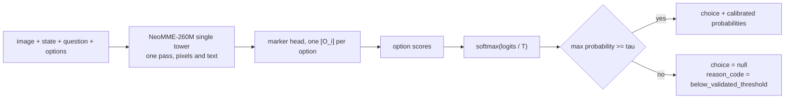
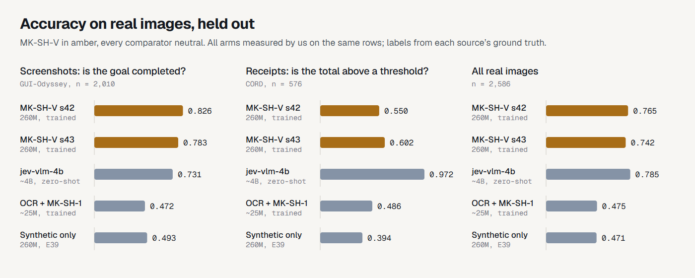
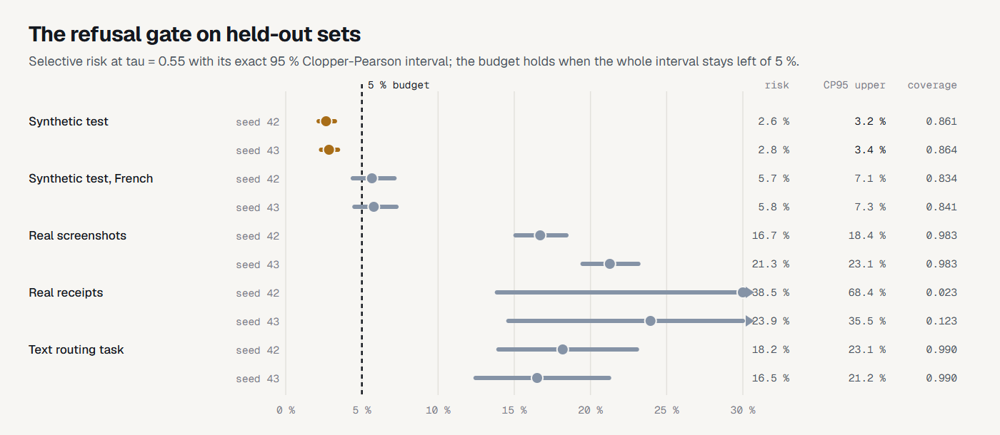

<table><tr>
<td></td>
<td><h1>MK-SH-V</h1><p><sub>a 260M visual decision model: calibrated probabilities, a choice, and a refusal below the gate</sub></p></td>
</tr></table>

A small open **visual decision model**: give it a document page or a phone or
desktop screenshot, a state, a question and a list of described options, and
it returns calibrated probabilities, a choice, and an explicit abstention when
confidence sits below a gate whose risk was validated on held-out data. It is
the visual sibling of [MK-SH-1](https://github.com/Gjusev/MK-SH-1): the same
whale shark, with its band in the amber of the gate.

<p align="center">
  <a href="https://cdn.jsdelivr.net/gh/Gjusev/mk-sh-v@main/assets/mkshv-film.mp4"></a>
  <br><sub>27-second film, every number measured (muted loop; click for the video with sound).</sub>
</p>

Public model: `Gjusev/MK-SH-V` on Hugging Face (upload pending; `MODEL_CARD.md`
is the release text). Interactive demo: `Gjusev/MK-SH-V-demo` (source in
[`demo/`](demo/)). Weights: the two E41 checkpoints (seeds 42 and 43),
NeoMME-260M fine-tuned on our synthetic generator plus real CC BY data (CORD
receipts, GUI-Odyssey screenshots); calibration and the gate came after
(E42), fitted on calibration splits disjoint from every reported set.

```
image:     a receipt photo, or a screenshot of an app
state:     "Goal: print orders_nov.csv for the records"
question:  "Does the screenshot show the goal as completed?"
options:   [ false: "No"  true: "Yes" ]
→  probabilities over the options (temperature-calibrated)
   choice (or null + reason_code when the policy abstains)
```

It is **not** a chat model and generates no text. One encoder pass reads the
image and the text together; each option is marked inline and scored by a
shared head; the softmax runs over the valid options only.

## The decision contract

One tower, a scalar score per option. The temperature is a monotone transform:
it never changes a choice, only the confidences. The gate was fitted on a
calibration split by a rule frozen before any held-out evaluation (E42): the
smallest threshold whose Clopper-Pearson 95 % upper bound on selective risk
stays within the 5 % budget.




The same contract as an instrument: the three pages on the carriage are real
E42 calibration cases with their measured probabilities (0.92 and 0.58 pass
the gate, 0.32 abstains). The interactive version ships in the demo.

## Measured against the field

<picture>
  <source media="(prefers-color-scheme: dark)" srcset="assets/chart-accuracy-dark.png">
  
</picture>

Every arm was run by us on the same 2,586 real held-out cases with pinned
revisions; labels come from each source's ground truth. On real screenshots
the 260M model leads a ~15× larger zero-shot model; on receipt thresholds it
does not, and a deterministic rules baseline (0.594) sits level with it there.
Overall the two are statistically close (Δ CI95 [−5.4, +1.2] pp, seed 42).
That comparator may have seen these sources in pretraining; its card cannot
tell us.

| Arm | Params | Real overall | Receipts (CORD) | Screenshots (GUI) |
|---|---|---|---|---|
| **MK-SH-V s42** | **260M** | **0.765** | 0.550 | **0.826** |
| **MK-SH-V s43** | **260M** | **0.742** | 0.602 | 0.783 |
| jev-vlm-4b, zero-shot | ~4B | 0.785 | 0.972 | 0.731 |
| OCR → MK-SH-1 | ~25M | 0.475 | 0.486 | 0.472 |
| Same model, synthetic only (E39) | 260M | 0.471 | 0.394 | 0.493 |

Adding real data moved real accuracy by +29.4 pp (CI95 [+25.9, +32.9], seed
42) and +27.2 pp ([+23.3, +31.3], seed 43), paired by episode. The declared
cost: −2.5 pp on the synthetic test (0.908 and 0.909), concentrated in two
families. Text competence from MK-SH-1 is kept through replay: testC 1.000,
routing task 0.810 and 0.830.

## The refusal gate, held out

<picture>
  <source media="(prefers-color-scheme: dark)" srcset="assets/chart-gate-dark.png">
  
</picture>

> On our held-out synthetic evaluation, both 260M checkpoints achieved over
> 86 % coverage while maintaining a 95 % Clopper-Pearson upper confidence
> bound on selective risk below 5 %.

That sentence is the whole claim, and the chart shows where it stops. On real
screenshots the gate keeps 98 % of cases while 17 to 21 % of the kept answers
are wrong; on real receipts it refuses almost everything (coverage 2 to 12 %).
The confidence signal that separates right from wrong on the synthetic
distribution does not yet do so on real images. That is the campaign's open
problem, published with its per-set tables (`runs/e42-calib/`), not hidden.

## Use cases

Each case names the measured capability it rests on, and where the
measurement stops.

1. **Task completion over screenshots.** "Does this screenshot show the goal
   as completed": agent supervision, UI QA, step verification. Rests on
   GUI-Odyssey held-out pairs, 0.826 and 0.783. Bound: binary completion
   questions in EN, ES and DE built from that corpus; not a general GUI
   understanding model, and the gate is not validated on real screens.
2. **Document state decisions.** Document type, form completeness, printed
   thresholds. Rests on the E38 synthetic families (five of seven at ceiling)
   and CORD real receipts, 0.550 and 0.602. Bound: on receipt thresholds the
   rules baseline is level and the large comparator is ahead; IDR-formatted
   totals are the declared gap.
3. **Calibrated scoring with a safety valve.** Decision queues where refusals
   route to a human. Rests on the E42 held-out result above. Bound: the
   guarantee holds on the evaluated synthetic distribution only.
4. **Mixed text and visual queues.** Rests on the retained text sets (testC
   1.000, task 0.810 and 0.830). Bound: descriptive; the shipped policy was
   fitted on the visual calibration split.

## Rigor

The claims are only as good as the record, and the record includes its
corrections:

- **Criteria frozen before measurement, every time.** E37 to E42 criteria are
  committed before any job runs (`docs/E*_CRITERIA_*.md`); amendments land as
  commits with their evidence, before results are read.
- **A mislabel corrected in public.** E39's kernel printed "transfer
  supported" on a statistical tie; the frozen criteria and the report say
  "advantage only on synthetic, no evidence of transfer", and that is what the
  record keeps. The tie motivated E41.
- **A wrong rule, replaced before it was used again.** E40's threshold rule
  (point risk) landed on the budget edge; the CP upper-bound rule was frozen
  for E42 before any E41 calibration output existed, and the cross-check
  against the old rule ships in every E42 summary.
- **The evaluation that guided the fix is disclosed.** The E38c real set was
  inspected for error analysis before E41 designed its training data; it was
  never trained or tuned on, and all selection used separate dev splits.
- **Comparators measured, not quoted.** jev-vlm-4b and OCR → MK-SH-1 were run
  by us on the same rows with pinned revisions.

Every number regenerates from per-case files under `runs/` with the scripts
in `scripts/`. Statistics: episode-grouped paired bootstrap (1,000 resamples,
seed 42); risk intervals exact two-sided Clopper-Pearson with the budget on
the upper end.

## Repository layout

```
docs/        frozen criteria per experiment, licence review
src/mksh_v/  model, generators, splitting, statistics
kaggle/      kernel scripts (self-contained builds via build_kernels.py)
scripts/     generators, verifiers, post-hoc gate reports, HF push
runs/        per-case outputs of every experiment (release bundle)
release/     inference-policy.json and export artifacts
demo/        the interactive demo (Space source)
assets/      mark, charts, film; sources and build scripts in assets/src/
tests/       unit tests incl. every kernel's math under test
```

## Provenance and licences

Code and weights: Apache-2.0. Training data: our synthetic generator
(Apache-2.0) plus CORD v2 train and GUI-Odyssey task_split train (both CC BY
4.0, attribution kept, images byte-identical, labels re-derived from the
sources' ground truth with rules committed before generation). The film's
soundtrack is generated in code; its effects are Kenney (CC0); type is Geist
(SIL OFL 1.1). Full tables: `THIRD_PARTY_NOTICES.md` and
`docs/data-licenses.md`.

Sibling text model: [MK-SH-1](https://github.com/Gjusev/MK-SH-1) (Hugging
Face: [Gjusev/MK-SH-1](https://huggingface.co/Gjusev/MK-SH-1)).
