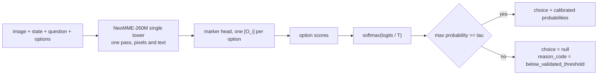

# MK-SH-V

**a 260M visual decision model: a page or screenshot in, calibrated
probabilities out, a choice, and a refusal below the gate**

A small open **visual decision model**: given an image (a document page or a
phone or desktop screenshot), a state, a question and a list of described
options, it returns calibrated probabilities, a choice, and when confidence
is too low, an explicit abstention. The repository carries the training and
evaluation system behind it: a six-experiment campaign (E37 to E42) with
criteria frozen and committed before every measurement, per-case outputs for
every published number, and the failure modes written next to the results.

Public model (pending upload, `MODEL_CARD.md` is the release text): the two
E41 checkpoints (seeds 42/43), trained from the NeoMME-260M backbone with
our synthetic generator plus real CC-BY data (CORD train receipts,
GUI-Odyssey task_split train episodes). Calibration and the abstention
policy (E42) were added without retraining: one temperature and one gate per
checkpoint, fitted on calibration splits disjoint from every reported set.

```
image:     a receipt photo, or a screenshot of an app
state:     "Goal: print orders_nov.csv for the records"
question:  "Does the screenshot show the goal as completed?"
options:   [ false: "No"  true: "Yes" ]
→  probabilities over the options (temperature-calibrated)
   choice (or null + reason_code when the policy abstains)
```

It is **not** a chat model and does not generate text. One encoder pass
reads the image and the text together; each option is marked inline and
scored by a shared head; the softmax runs over the valid options only.

## The decision contract

One single tower, a scalar score per option. The temperature is a monotone
transform: it never changes a choice, only the confidences. The gate was
fitted on a calibration split by a rule frozen before any held-out
evaluation (E42): the smallest threshold whose Clopper-Pearson 95 % upper
bound on selective risk stays within the 5 % budget.



## Use cases

Each case names the measured capability it rests on, and where the
measurement stops.

1. **Task completion over screenshots.** "Does this screenshot show the goal
   as completed": agent supervision, UI QA, step verification. Rests on
   GUI-Odyssey held-out pairs: 0.826/0.783 (two seeds) against 0.731 for a
   zero-shot ~4B comparator, 0.472 for an OCR pipeline, 0.493 for the same
   model trained on synthetic screens only (E39 vs E41). Bound: binary
   completion questions in EN/ES/DE built from that corpus; not a general
   GUI understanding model.
2. **Document state decisions.** Document type, form completeness, printed
   thresholds ("is the total at least X"). Rests on E38 synthetic families
   (five of seven at ceiling) and CORD real receipts 0.550/0.602. Bound: on
   receipt thresholds a deterministic rules baseline still reaches 0.594 and
   the large comparator 0.972; threshold questions over IDR-formatted totals
   are the declared open gap.
3. **Calibrated scoring with a safety valve.** On the held-out synthetic
   test both checkpoints keep over 86 % coverage with a CP95 upper bound on
   selective risk of 3.2 to 3.4 % (E42). Suited to decision queues where
   refusals route to a human. Bound: that guarantee holds on the evaluated
   synthetic distribution; on real images the gate keeps confident errors
   (GUI, 17 to 21 % risk at 98 % coverage) or refuses nearly everything
   (CORD). Published as the campaign's open problem, with the per-set
   tables.
4. **Mixed text and visual queues.** The text competence of the sibling
   MK-SH-1 line is retained (testC 1.000, task 0.810/0.830) through replay
   mixing. Bound: descriptive; the shipped policy was fitted on the visual
   calibration split.

## Measured results

Real images (2,586 held-out cases, labels from the sources' ground truth):

| Arm | Params | Real | CORD | GUI |
|---|---|---|---|---|
| **MK-SH-V s42** | **260M** | **0.765** | 0.550 | **0.826** |
| **MK-SH-V s43** | **260M** | **0.742** | 0.602 | 0.783 |
| jev-vlm-4b (zero-shot) | ~4B | 0.785 | 0.972 | 0.731 |
| OCR → MK-SH-1 | ~25M | 0.475 | 0.486 | 0.472 |
| MK-SH-V, synthetic-only | 260M | 0.471 | 0.394 | 0.493 |

Synthetic held-out test: 0.908/0.909 (declared cost of adding real data:
−2.5 pp, concentrated in two families; five at ceiling). Text: testC
1.000/1.000, task 0.810/0.830.

Abstention (E42, held-out, exact Clopper-Pearson 95 %):

| Set | Coverage | Selective risk | 95 % interval | 5 % budget |
|---|---|---|---|---|
| synthetic test s42 | 0.861 | 2.65 % | 2.2 to 3.2 % | **held** |
| synthetic test s43 | 0.864 | 2.84 % | 2.3 to 3.4 % | **held** |
| real GUI s42/s43 | 0.983 | 16.7 / 21.3 % | below 23.1 % | missed |
| real CORD s42/s43 | 0.023 / 0.123 | 38.5 / 23.9 % | wide | missed |
| text testC (n=48) | 1.000 | 0 % | 0 to 7.4 % | n too small |

Every number regenerates from per-case files under `runs/` with the scripts
in `scripts/` (for example `scripts/report_e41.py`). Statistics: episode
grouped paired bootstrap (1,000 resamples, seed 42); risk intervals exact
two-sided Clopper-Pearson with the budget on the upper end.

## Rigor

The campaign's claims are only as good as its record, and the record
includes its corrections:

- **Criteria frozen before measurement, every time.** E37 to E42 criteria
  are committed before any job runs (`docs/E*_CRITERIA_*.md`); amendments
  land as commits with their evidence, before results are read.
- **A mislabel corrected in public.** E39's kernel printed "transfer
  supported" on a statistical tie; the frozen criteria and the report say
  "advantage only on synthetic, no evidence of transfer", and that is what
  the record keeps. The tie then motivated E41.
- **A wrong rule, replaced before it was used again.** E40's threshold rule
  (point risk) landed the operating point on the budget edge; the corrected
  rule (CP upper bound) was frozen for E42 before any E41 calibration
  output existed, and the cross-check against the old rule ships in every
  E42 summary.
- **The evaluation that guided the fix is disclosed.** The E38c real
  evaluation set was inspected for error analysis before E41 designed its
  training data; it was never trained or tuned on, all selection used
  separate dev splits, and the disclosure is in the model card.
- **Comparators measured, not quoted.** jev-vlm-4b and OCR→MK-SH-1 were run
  by us on the same rows with pinned revisions; no public benchmark numbers
  are cross-quoted for our tables.

## Repository layout

```
docs/        frozen criteria per experiment, licence review, status
src/mksh_v/  model, generators, splitting, statistics
kaggle/      kernel scripts (self-contained builds via build_kernels.py)
scripts/     generators, verifiers, post-hoc gate reports
runs/        per-case outputs of every experiment (release bundle)
release/     inference-policy.json and export artifacts
demo/        the interactive demo (Space source)
tests/       unit tests incl. every kernel's math under test
```

## Provenance and licenses

Code and weights: Apache-2.0. Training data: our synthetic generator
(Apache-2.0) plus CORD v2 train and GUI-Odyssey task_split train (both CC BY
4.0, attribution kept, images byte-identical, labels re-derived from the
sources' ground truth with rules committed before generation). Full tables:
`THIRD_PARTY_NOTICES.md` and `docs/data-licenses.md`.

Sibling text model: [MK-SH-1](https://github.com/Gjusev/MK-SH-1)
(Hugging Face: [Gjusev/MK-SH-1](https://huggingface.co/Gjusev/MK-SH-1)).
